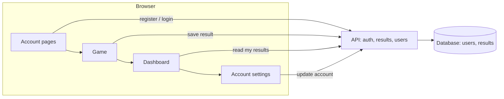

# Architecture sketch

Draft. Update when the stack is confirmed.

## Data sketch
- `users`: id, email, password_hash, display_name, created_at
- `results`: id, user_id, wins, losses, ties, predictability_score, played_at

## Open questions
- Does the predictor run in the browser or on the API? (Browser is simpler; API is harder to cheat.)
- How is a result protected from being faked by the client?
