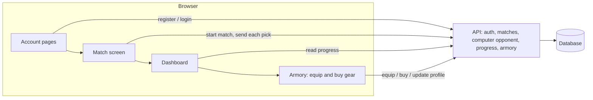

# Architecture sketch

Draft. Update when the stack is confirmed.

## Data (as built in `app/models.py`)
- `users`: id, email, password_hash, display_name, rank, stars, coins, streak, created_at
- `matches`: id, user_id, status (active / won / lost / abandoned), you, cpu, rounds (JSON list), rank_at_start, stars_change, coins_earned, started_at, finished_at
- `unlocks`: user_id, item_id, unlocked_at
- `loadouts`: user_id, fighter, item_id (one equipped item per fighter)

Changes from the Plan sketch:
- The planned `results` table became finished rows of `matches` (status won or lost). One table holds a match while it is played and after it ends.
- The gear catalog is a list in code (`app/game/items.py`), not an `items` table, because it only changes when the code does.

## Code layout
- `app/game/`: rules, computer opponent, match and progression as plain Python with no web or database code, so they are tested directly.
- `app/routers/`: the API (accounts, matches). `app/models.py`: tables. `app/security.py`: password hashing (scrypt) and login tokens (JWT, sent as an HttpOnly cookie or a Bearer header).

## API so far
| Method and path | What it does |
|---|---|
| POST /api/auth/register | Create an account and sign in |
| POST /api/auth/login, POST /api/auth/logout | Sign in and out |
| GET /api/me | The signed-in player's profile and progress |
| POST /api/matches | Start a match (abandons any unfinished one) |
| POST /api/matches/{id}/rounds | Send a pick; the server picks for the computer, decides the round, and on the final round saves the result and rewards |
| GET /api/matches/{id} | One of your own matches |
| GET /api/dashboard | Progress, win/loss stats, last 10 finished matches, gear collection and loadout |
| PATCH /api/me | Change display name |
| POST /api/me/password | Change password (needs the current one) |
| GET /api/armory | Gear with owned / equipped flags |
| POST /api/armory/buy | Buy an item with coins |
| PUT /api/armory/loadout | Equip an owned item on its fighter, or take it off |

## Key decision: the computer picks on the server
The player sends their pick; the API makes the computer's pick and decides the round. If the browser decided rounds, a player could fake wins and unlock everything.
