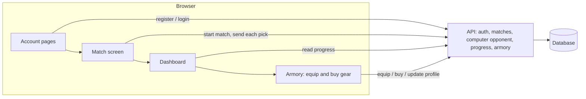

# Architecture sketch

Draft. Update when the stack is confirmed.

## Data sketch
- `users`: id, email, password_hash, display_name, rank, stars, coins, current_streak, created_at
- `results`: id, user_id, outcome, rounds_won, rounds_lost, rank_at_start, stars_change, coins_earned, played_at
- `items`: id, fighter (knight/archer/wizard), name, price, unlocked_by_rank (nullable)
- `unlocks`: user_id, item_id, unlocked_at
- `loadouts`: user_id, fighter, item_id

## Key decision: the computer picks on the server
The player sends their pick; the API makes the computer's pick and decides the round. If the browser decided rounds, a player could fake wins and unlock everything.
